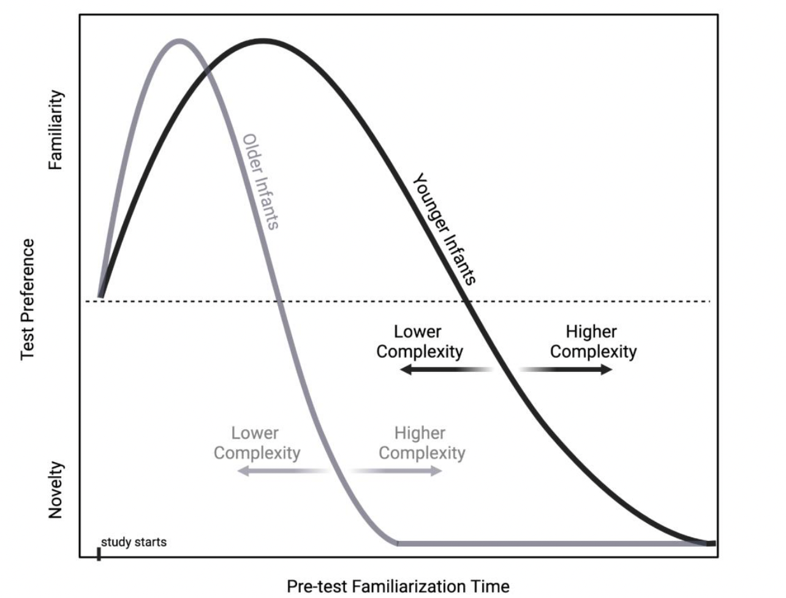

::: {layout="[ [1,1] ]"}

:::

# Preface {#sec-preface .unnumbered}

Thank you for contributing to , a project of !

::: {.callout-note title="important"}
### This lab manual is a living document

Please refer to this online version of the manual (rather than printing or saving a PDF) to get the most up-to-date information about the project. You can see when the manual was last updated via the "Published" date above.

**PLEASE REVIEW ALL OF THE MATERIAL IN THIS MANUAL CAREFULLY BEFORE DOING ANYTHING ELSE!**

**🚫 DO NOT BEGIN DATA COLLECTION FOR**  **UNTIL YOU HAVE COMPLETED THE SET-UP STEPS OUTLINED IN THIS MANUAL AND PROJECT LEADS HAVE GIVEN YOUR LAB A "GREEN-LIGHT"!! 🚫**
:::

::: {.callout-note title="note"}
#### Help us improve the manual!

If you find any errors (big or small!) or would like to suggest edits/improvements, we want to hear about it! You can let us know by creating an issue via the  <i>(click on `Issues` then `New issue`)</i>.
:::

 

## Manual Overview

This manual provides the information needed to participate in . The manual is divided into five sections ([General information](#sec-generalinfo), [Getting Started](#sec-gettingstarted), [Setting up the experiment](#sec-setup), [Running the experiment](#sec-running) & [After data collection](#sec-aftercollection)). Each section is divided into chapters, which you can jump to using the navigation panel on the left of the screen.

 

##  Overview

 is a cross-lab effort to provide an empirical basis for discussions of replicability as well as cultural, developmental, and methodological variability in infant perception/cognition research. In this project, we are examining drivers of infants’ familiarity vs. novelty preference through a collaboratively-designed “best test” of a popular model of infants’ visual preference for familiar and novel stimuli [@hunter1988]. More details about the background, design and hypotheses can be found in the  [@kosie]. In the following sections, we provide instructions for getting ready to run the experiment, implementing the experiment in your lab, and reporting data back to the project as a whole. Thanks for joining us!

{#fig-hunterames}

------------------------------------------------------------------------

### Acknowledgments

Much of this manual was adapted from the lab manuals created by the MB1, MB2, MB3, and MB4 teams. Some of the style elements have been borrowed/adapted from Experimentology[^index-1] [@experimentology2025].

[^index-1]: Special thanks to Mika Braginsky

------------------------------------------------------------------------

This is a [{width="20%"}](https://quarto.org/docs/books) book.

To learn more about Quarto books visit <https://quarto.org/docs/books>.

------------------------------------------------------------------------

### License

 This work is licensed under a <a rel="license" href="http://creativecommons.org/licenses/by-nc/4.0/">Creative Commons Attribution-NonCommercial 4.0 International License</a>.

------------------------------------------------------------------------
